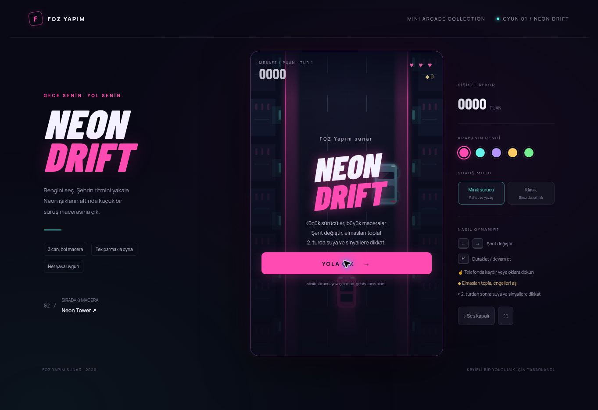

# Neon Drift

## [▶ TARAYICIDA OYNA](https://fozdemiroglu.github.io/neon-drift/)

**Oyuna başlamak için yukarıdaki bağlantıya veya aşağıdaki görsele tıkla.** İndirme, kurulum veya GitHub hesabı gerekmez. Telefonda ve bilgisayarda tarayıcıdan oynayabilirsin.

Neon yollarda sür, elmasları topla ve trafikten kaç. İkinci turda su birikintileri ve şerit değiştiren araçlara dikkat!

---

FOZ Yapım sunar.

Neon araba oyunu: beş araba rengi, Minik sürücü ve Klasik modları, üç can, elmaslar ve kalkan. İkinci turdan itibaren su birikintileri ve sinyal vererek şerit değiştiren araçlar bulunur.

## Kontroller

- Bilgisayar: sağ ve sol yön tuşları.
- Telefon: dokunmatik yön tuşları veya kaydırma.

Her tur 45 saniyedir. Üç can bitince oyun sona erer. Rekor bu tarayıcıda saklanır.

Derleme veya kurulum gerekmez; `index.html` doğrudan tarayıcıda açılabilir.

## Diğer FOZ Yapım oyunları

- [▶ Shadow Runner oyna](https://fozdemiroglu.github.io/shadow-runner/)
- [▶ Neon Tower oyna](https://fozdemiroglu.github.io/neon-tower/)
